

Martin De Kauwe is Professor of Global Change Ecology and Deputy Head of the School of Biological Sciences at the <a href="http://www.bristol.ac.uk/biology/">University of Bristol</a>.

Martin previously worked at the University of New South Wales, Macquarie University, and the UK Centre for Ecology &amp; Hydrology, and completed his PhD at University College London.

Martin is a member of the Scientific Steering Committee for the <a href="https://amazonface.unicamp.br/">AmazonFACE</a> experiment and part of the senior management team for <a href="https://jules.jchmr.org/">JULES</a> (the UK land surface model) under the Joint Land Modelling Programme (JLMP). Martin previously co-chaired the leadership committee for <a href="https://github.com/CABLE-LSM/CABLE">CABLE</a>, Australia's land surface model. Finally, Martin is an Editor at <a href="https://nph.onlinelibrary.wiley.com/journal/14698137">New Phytologist</a>.

<a href="mailto:m.dekauwe@bristol.ac.uk" class="social-links__entry" target="_blank" aria-label="Email"><i class="fa fa-envelope-square fa-lg" aria-hidden="true"></i></a>
<a href="https://github.com/mdekauwe" class="social-links__entry" target="_blank" aria-label="GitHub"><i class="fa fa-github fa-lg" aria-hidden="true"></i></a>
<a href="https://scholar.google.com.au/citations?user=ka3U7xcAAAAJ&hl=en" class="social-links__entry" target="_blank" aria-label="Google Scholar"><i class="fa fa-graduation-cap fa-lg" aria-hidden="true"></i></a>
<a href="https://orcid.org/0000-0002-3399-9098" class="social-links__entry" target="_blank" aria-label="ORCID"><i class="ai ai-orcid" aria-hidden="true"></i></a>
<a href="https://bsky.app/profile/mdekauwe.bsky.social" class="social-links__entry" target="_blank" aria-label="Bluesky"><svg class="icon-bluesky" viewBox="0 0 600 530" aria-hidden="true"><path fill="currentColor" d="m135.72 44.03c66.496 49.921 138.02 151.14 164.28 205.46 26.262-54.316 97.782-155.54 164.28-205.46 47.98-36.021 125.72-63.892 125.72 24.795 0 17.712-10.155 148.79-16.111 170.07-20.703 73.984-96.144 92.854-163.25 81.433 117.3 19.964 147.14 86.092 82.697 152.22-122.39 125.59-175.91-31.511-189.63-71.766-2.514-7.3797-3.6904-10.832-3.7077-7.8964-0.0174-2.9357-1.1937 0.51669-3.7077 7.8964-13.714 40.255-67.233 197.36-189.63 71.766-64.444-66.128-34.605-132.26 82.697-152.22-67.108 11.421-142.55-7.4491-163.25-81.433-5.9562-21.282-16.111-152.36-16.111-170.07 0-88.687 77.742-60.816 125.72-24.795z"/></svg></a>

<!--
### Research Positions

2021–present: Professor, School of Biological Sciences, University of Bristol, England

2017–2021: Senior Lecturer, Climate Change Research Centre, University of New South Wales, Australia

2010–2017: Research Fellow, Department of Biological Sciences, Macquarie University, Australia

2008–2010: Land Surface Modeller, Centre for Ecology and Hydrology, England
-->

<!--
### Education

2009: PhD in Remote Sensing, University College London, UK. Title: "Estimating terrestrial carbon fluxes through an optimal combination of models and Earth Observation data" . Supervised by Professors Philip Lewis, Mat Disney and Mathew Williams.

2004: MSc in Environmental Monitoring, Modelling and Management, Kings College London, UK.

2003: BSc in Geography, Kings College London, UK.
-->

### Research group

#### Postdocs
{: .role-heading}

Lirong You is a Postdoctoral Researcher at the University of Bristol.

Lirong is working on our UK Natural Environment Research Council (NERC) grant to characterise the timescales, spatial extent, and mechanisms that govern ecosystem legacies to drought and heatwaves during European summers.

<a href="mailto:gk25435@bristol.ac.uk" class="social-links__entry" target="_blank" aria-label="Email"><i class="fa fa-envelope-square fa-lg" aria-hidden="true"></i></a>

#### PhD students
{: .role-heading}

Valentina Lara Rivera is a PhD student at the University of Exeter in <a href="https://experts.exeter.ac.uk/20181-lina-mercado">Lina Mercado's</a> group. Valentina's PhD will explore the response of European forest to heatwaves.

<a href="mailto:V.Lara-Rivera@exeter.ac.uk" class="social-links__entry" target="_blank" aria-label="Email"><i class="fa fa-envelope-square fa-lg" aria-hidden="true"></i></a>

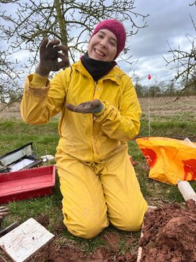

Chrysanthi Economou is a PhD student at the University of Reading in <a href="https://www.trees-in-fields-network.co.uk/">Amelia Hood's</a> group. Chrysanthi's PhD will explore agroforestry solutions for soil health, climate resilience, and food security.

<a href="mailto:chrysanthi.economou@pgr.reading.ac.uk" class="social-links__entry" target="_blank" aria-label="Email"><i class="fa fa-envelope-square fa-lg" aria-hidden="true"></i></a>

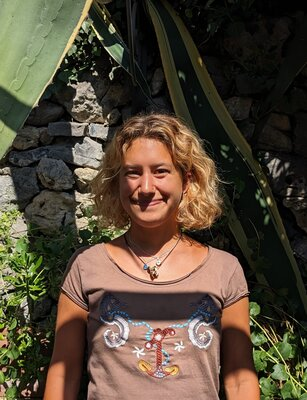

Julia Madurini Hall is a PhD student at the University of Bristol in the <a href="https://www.selvalab.org/">Selva lab</a>. Julia's PhD will use manipulative experiments to advance our understanding of how trees respond to drought and heat stress.

<a href="mailto:julia.hall.2021@bristol.ac.uk" class="social-links__entry" target="_blank" aria-label="Email"><i class="fa fa-envelope-square fa-lg" aria-hidden="true"></i></a>

Thamali Kariyawasam Idippilige is a PhD student at the University of Bristol. Thamali's PhD is investigating water-use efficiency and drought tolerance in Sri Lankan tea cultivars.

Thamali's PhD scholarship is a partnership between Bristol, the <a href="https://www.kew.org/">Royal Botanic Gardens, Kew</a>, the <a href="https://www.pdn.ac.lk/">University of Peradeniya in Sri Lanka</a>, and the <a href="https://www.tri.lk/">Tea Research Institute of Sri Lanka</a>, with funding from <a href="https://www.ahmadtea.com/">Ahmad Tea</a>.

<a href="mailto:er24915@bristol.ac.uk" class="social-links__entry" target="_blank" aria-label="Email"><i class="fa fa-envelope-square fa-lg" aria-hidden="true"></i></a>

#### MRes students
{: .role-heading}

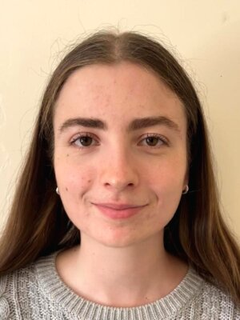

Emilie Revill-Hivet is an MRes student at the University of Bristol. Emilie will investigate the legacy impacts of climate extremes, with a particular focus on assessing the extent of canopy dieback associated with hot and dry summers across Europe.

<a href="mailto:vv22430@bristol.ac.uk" class="social-links__entry" target="_blank" aria-label="Email"><i class="fa fa-envelope-square fa-lg" aria-hidden="true"></i></a>

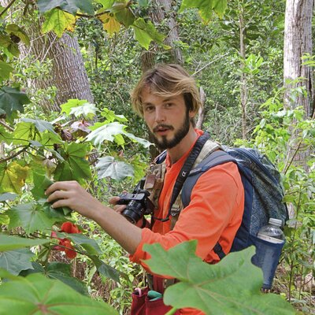

Ross Upton is an MRes student at the University of Bristol. Ross is investigating opportunities for developing climate-resilient afforestation schemes.

<a href="mailto:f19577@bristol.ac.uk" class="social-links__entry" target="_blank" aria-label="Email"><i class="fa fa-envelope-square fa-lg" aria-hidden="true"></i></a>

### Alumni - gone but not forgotten

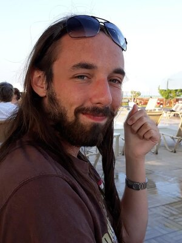

Cale Baguley was a Postdoctoral Researcher at the University of Bristol.

Cale worked on our UK Natural Environment Research Council (NERC) funded project, investigating how drought causes xylem impairment and implementing these processes within the JULES model to capture the legacy effects of drought across successive summers.

<a href="mailto:jb14389@bristol.ac.uk" class="social-links__entry" target="_blank" aria-label="Email"><i class="fa fa-envelope-square fa-lg" aria-hidden="true"></i></a>
<a href="https://scholar.google.com/citations?user=kvGSPQYAAAAJ&hl=en" class="social-links__entry" target="_blank" aria-label="Google Scholar"><i class="fa fa-graduation-cap fa-lg" aria-hidden="true"></i></a>

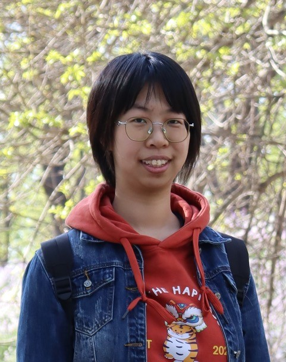

Xueyan Cheng, visiting PhD student from the University of Freiburg. Xueyan is exploring how the land surface responds to wet and dry extremes.

<a href="mailto:xueyan.cheng@ecoclim.uni-freiburg.de" class="social-links__entry" target="_blank" aria-label="Email"><i class="fa fa-envelope-square fa-lg" aria-hidden="true"></i></a>
<a href="https://scholar.google.com/citations?user=2tvrOHQAAAAJ&hl=en" class="social-links__entry" target="_blank" aria-label="Google Scholar"><i class="fa fa-graduation-cap fa-lg" aria-hidden="true"></i></a>

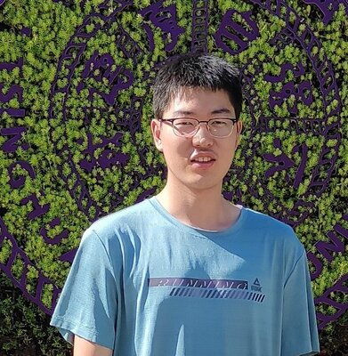

Ziqi Zhu, visiting PhD student from Tsinghua University. Ziqi is applying eco-evolutionary optimality principles to understand trends in seasonal dynamics in leaf growth.

<a href="mailto:zq-zhu20@tsinghua.org.cn" class="social-links__entry" target="_blank" aria-label="Email"><i class="fa fa-envelope-square fa-lg" aria-hidden="true"></i></a>
<a href="https://www.researchgate.net/profile/Ziqi-Zhu-10/publications" class="social-links__entry" target="_blank" aria-label="ResearchGate"><i class="ai ai-researchgate" aria-hidden="true"></i></a>

Ying Hu, visiting PhD student from the Research Center for Eco-environmental Sciences, Chinese Academy of Sciences. Ying is exploring the impact of climate change on Chinese terrestrial ecosystems.

<a href="mailto:huying20@mails.ucas.ac.cn" class="social-links__entry" target="_blank" aria-label="Email"><i class="fa fa-envelope-square fa-lg" aria-hidden="true"></i></a>
<a href="https://scholar.google.com.au/citations?hl=en&user=oo7FaoYAAAAJ" class="social-links__entry" target="_blank" aria-label="Google Scholar"><i class="fa fa-graduation-cap fa-lg" aria-hidden="true"></i></a>

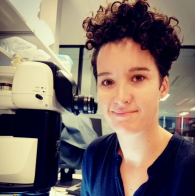

Melika Missen, PhD student, Thesis: <i>Will rising CO2 concentrations save plants from drought stress?</i>

Melika has completed her PhD.

<a href="mailto:melika.missen@utas.edu.au" class="social-links__entry" target="_blank" aria-label="Email"><i class="fa fa-envelope-square fa-lg" aria-hidden="true"></i></a>
<a href="https://scholar.google.com/citations?user=RJHRL60AAAAJ&hl=en" class="social-links__entry" target="_blank" aria-label="Google Scholar"><i class="fa fa-graduation-cap fa-lg" aria-hidden="true"></i></a>

Jonathan Page, PhD student, Thesis: <i>Lags and legacies: understanding the role of antecedent effects on grassland biomass responses to rising CO2</i>. Jon received the Dean’s Award for an outstanding PhD thesis.

Jon is now working as a postdoc at the University of New South Wales.

<a href="mailto:jon.page@unsw.edu.au" class="social-links__entry" target="_blank" aria-label="Email"><i class="fa fa-envelope-square fa-lg" aria-hidden="true"></i></a>
<a href="https://scholar.google.com.au/citations?hl=en&user=yEtrmdMAAAAJ" class="social-links__entry" target="_blank" aria-label="Google Scholar"><i class="fa fa-graduation-cap fa-lg" aria-hidden="true"></i></a>

Gabriel Banstarck Marandola, visiting master's student from the State University of Campinas. Gabriel completed his MSc in Ecology in 2024.

Gabriel's thesis evaluated the effects of elevated CO2 on the physiology of understory species in Central Amazonia.

<a href="mailto:g171857@dac.unicamp.br" class="social-links__entry" target="_blank" aria-label="Email"><i class="fa fa-envelope-square fa-lg" aria-hidden="true"></i></a>

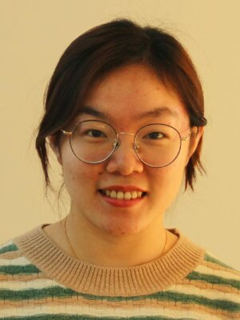

Chunhui Zhan, visiting PhD student from the Max Planck Institute for Biogeochemistry.

Chunhui is examining the role of rising carbon dioxide on land-atmosphere interactions.

<a href="mailto:czhan@bgc-jena.mpg.de" class="social-links__entry" target="_blank" aria-label="Email"><i class="fa fa-envelope-square fa-lg" aria-hidden="true"></i></a>
<a href="https://www.bgc-jena.mpg.de/person/czhan/4908500" class="social-links__entry" target="_blank" aria-label="Website"><i class="fa fa-globe fa-lg" aria-hidden="true"></i></a>

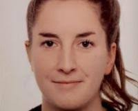

Lina Teckentrup, PhD student, Thesis: <i>The Future of Terrestrial Carbon in Australia</i>

Lina is now working as a research scientist at the Barcelona Supercomputer Center.

<a href="mailto:l.teckentrup@unsw.edu.au" class="social-links__entry" target="_blank" aria-label="Email"><i class="fa fa-envelope-square fa-lg" aria-hidden="true"></i></a>
<a href="https://scholar.google.com.au/citations?hl=en&user=MzjKIsoAAAAJ" class="social-links__entry" target="_blank" aria-label="Google Scholar"><i class="fa fa-graduation-cap fa-lg" aria-hidden="true"></i></a>

Mengyuan Mu, PhD student, Thesis: <i>How important is groundwater to the resilience of vegetation during drought?</i>

Mengyuan is now working as a Postdoc at the University of New South Wales.

<a href="mailto:mengyuan.mu@unsw.edu.au" class="social-links__entry" target="_blank" aria-label="Email"><i class="fa fa-envelope-square fa-lg" aria-hidden="true"></i></a>
<a href="https://scholar.google.com.au/citations?hl=en&user=e5bnO9gAAAAJ" class="social-links__entry" target="_blank" aria-label="Google Scholar"><i class="fa fa-graduation-cap fa-lg" aria-hidden="true"></i></a>

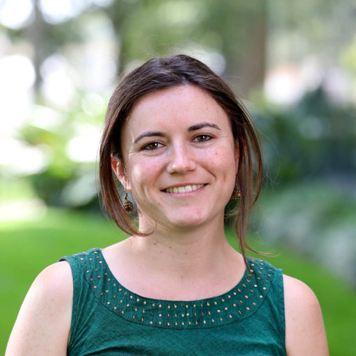

Manon Sabot, PhD student Thesis: <i>Trading water for carbon in a changing climate: Can optimality theory improve the predictability of land surface models?</i> Manon received the Dean’s Award for an outstanding PhD thesis.

Following her PhD, Manon worked as a Postdoctoral Researcher on our ARC grant exploring how vulnerable eucalypts are to future drought. Manon is a Minerva Fast Track fellow and group leader at the <a href="https://www.bgc-jena.mpg.de/person/msabot/4777702">Max Planck Institute for Biogeochemistry</a>.

<a href="mailto:msabot@bgc-jena.mpg.de" class="social-links__entry" target="_blank" aria-label="Email"><i class="fa fa-envelope-square fa-lg" aria-hidden="true"></i></a>
<a href="https://scholar.google.com.au/citations?hl=en&user=Pce-a8UAAAAJ" class="social-links__entry" target="_blank" aria-label="Google Scholar"><i class="fa fa-graduation-cap fa-lg" aria-hidden="true"></i></a>

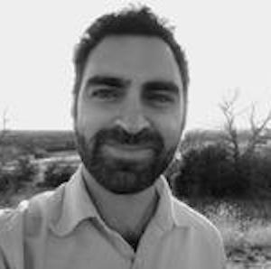

Sami Rifai, Postdoctoral Researcher on the ARC Discovery: "How vulnerable are eucalypts to future droughts?"

Sami now a lecturer in the School of Biological Sciences at the <a href="https://researchers.adelaide.edu.au/profile/sami.rifai">University of Adelaide</a>.

<a href="https://scholar.google.com.au/citations?hl=en&user=2GmEDKAAAAAJ" class="social-links__entry" target="_blank" aria-label="Google Scholar"><i class="fa fa-graduation-cap fa-lg" aria-hidden="true"></i></a>

Jinyan (Jim) Yang, PhD student, Thesis: <i>Modelling the carbon uptake of Australian evergreen ecosystems under rising [CO2] and water limitations</i>

Jim is now working as a Postdoc at CSIRO Environment.

<a href="https://scholar.google.com.au/citations?hl=en&user=6f7VyFoAAAAJ" class="social-links__entry" target="_blank" aria-label="Google Scholar"><i class="fa fa-graduation-cap fa-lg" aria-hidden="true"></i></a>

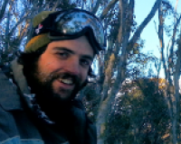

Ned Haughton, PhD student, Thesis: <i>On the predictability of land surface fluxes</i>

Ned is now working as a risk analyst at Climate Risk.

<a href="https://scholar.google.com.au/citations?hl=en&user=iMq-xHEAAAAJ" class="social-links__entry" target="_blank" aria-label="Google Scholar"><i class="fa fa-graduation-cap fa-lg" aria-hidden="true"></i></a>

### Mini reunion in Bristol, 2022

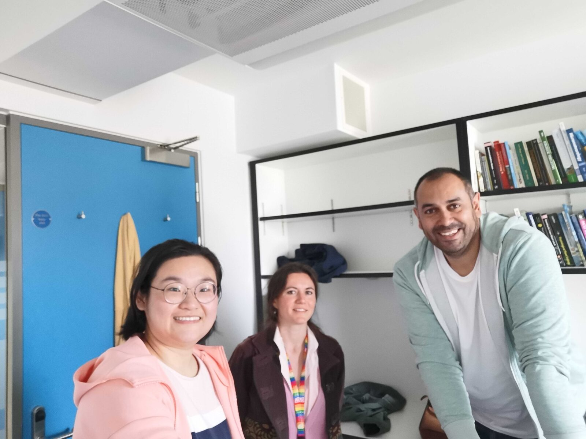
