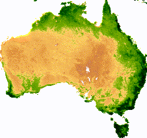
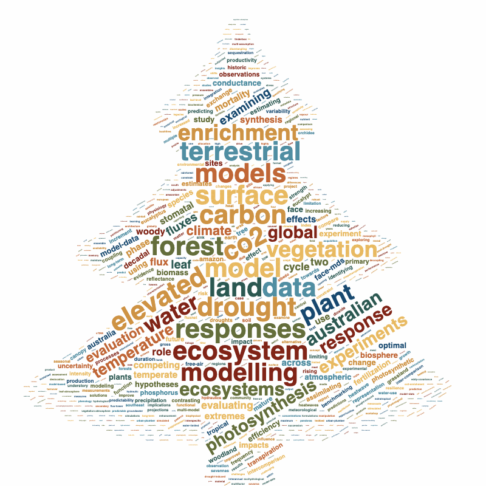

Our research group studies how plants respond to global environmental changes, including rising CO2, warming, and shifts in water availability, with a particular interest in how these changes affect ecosystem carbon and water cycles. We integrate multiple observation data streams — from manipulation experiments, eddy covariance, and satellite data — with vegetation models and statistical methods to advance process understanding and improve predictions of future ecosystem change.

<!-- 

 -->
<video class="animation" autoplay muted loop playsinline aria-label="Animation of gross primary productivity simulated by CABLE">
<source src="assets/img/cable_gpp_animation.webm" type="video/webm">
<source src="assets/img/cable_gpp_animation.mp4" type="video/mp4">
</video>

We tackle a diverse range of questions that connect terrestrial ecosystems with climate, including:

#### Plant function, stress, and disturbance dynamics
{: .role-heading}

- How will plants acclimate and adapt to rising atmospheric CO2 concentrations?
- To what extent can plants adjust their physiology and function under environmental stress?
- Can we predict when and where trees will die during droughts?
- How do changing disturbance regimes shape forest structure, function and resilience?
- How do past environmental conditions influence ecosystem resilience to droughts and heatwaves?

#### Ecosystem and climate feedbacks
{: .role-heading}

- How does plant function regulate land–atmosphere feedbacks during climate extremes?
- How will vegetation responses to environmental change alter the terrestrial hydrological cycle?

#### Biogeography and future landscapes
{: .role-heading}

- How resilient are species distributions to climate change, and how will they shift in the future?
- How effectively can nature-based forest restoration mitigate the impacts of droughts and heatwaves?
- Which species should we plant in future landscapes and cities to enhance climate resilience?

Modelling is a central tool used by our research group for understanding, disentangling, and projecting how climate change will shape future vegetation-atmosphere dynamics. We use models spanning a range of complexity:

- Simple: <a href="https://github.com/mdekauwe/GDAY">GDAY</a>
- Stand: <a href="http://maespa.github.io/">MAESPA</a>
- Land surface: <a href="https://github.com/CABLE-LSM/CABLE">CABLE</a>, <a href="https://jules.jchmr.org/">JULES</a>
- Dynamic vegetation: <a href="http://iis4.nateko.lu.se/lpj-guess/">LPJ-GUESS</a>
- Coupled climate: <a href="https://www.access-nri.org.au/">ACCESS</a>

"The method of science depends on our attempts to describe the world with simple theories: theories that are complex may become untestable, even if they happen to be true. Science may be described as the art of systematic over-simplification&mdash;the art of discerning what we may with advantage omit."

Karl Popper

